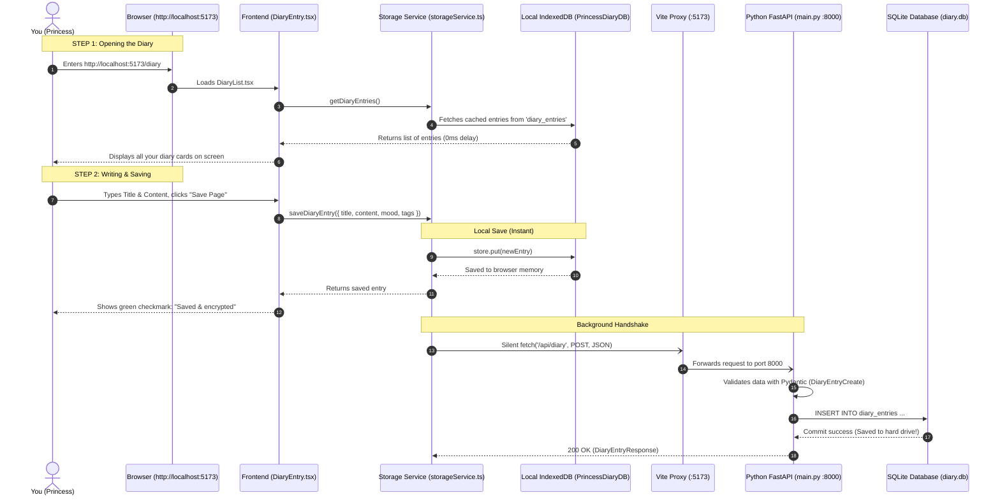

# 📖 Complete Code Walkthrough: Opening the Diary & Clicking "Save Page"

This document explains **step-by-step and line-by-line** what happens under the hood when:
1. You open `http://localhost:5173/diary` in your web browser.
2. You click **"Write New Memory"**, write your thoughts, and click **"Save Page"**.

We will look at the real code in **Frontend (React)**, the **Network Bridge (Vite)**, the **Backend (Python FastAPI)**, and the **Database (SQLite)** in plain English.

---

## 🗺️ The Complete Visual Flow



---

## 🚪 Part 1: What Happens When You Open `http://localhost:5173/diary`?

When you type `http://localhost:5173/diary` into your web browser:

### 1. The Route in React (`frontend/src/App.tsx`)
React matches the URL `/diary` and renders the component **`DiaryList.tsx`**.

### 2. Loading Existing Entries (`frontend/src/pages/Diary/DiaryList.tsx`)
Inside `DiaryList.tsx`, a special React hook called `useEffect` runs as soon as the screen loads:

```typescript
// File: frontend/src/pages/Diary/DiaryList.tsx (Lines 25-39)
const loadData = useCallback(async () => {
  try {
    await ensureInitialSeed();
    const data = await getDiaryEntries(); // 👈 1. Asks storageService for your diary entries
    setEntries(data);                     // 👈 2. Puts the entries into React state to draw them
  } catch (err) {
    console.error('Failed to load diary entries:', err);
  } finally {
    setLoading(false);                    // 👈 3. Hides the loading spinner
  }
}, []);

useEffect(() => {
  loadData();
}, [loadData]);
```

**What does this mean?**
* The screen immediately calls `getDiaryEntries()`.
* It pulls your saved diary pages directly from your browser's private **IndexedDB** storage. Because this happens in your local computer's memory, your diary pages pop up **instantly** without waiting for the internet!

---

## ✍️ Part 2: You Click "Write New Memory"

In `DiaryList.tsx`, there is a button:

```typescript
// File: frontend/src/pages/Diary/DiaryList.tsx
<button
  onClick={() => navigate('/diary/new')}
  className="btn-princess flex items-center gap-2"
>
  <PenLine size={15} />
  <span>Write New Memory</span>
</button>
```

When you click it:
1. React changes the URL to `http://localhost:5173/diary/new`.
2. React unmounts `DiaryList.tsx` and loads **`DiaryEntry.tsx`**.
3. It gives you a clean diary sheet with inputs for:
   * **Title**: `title`
   * **Content**: `content`
   * **Mood**: `mood` (e.g. peaceful, happy, in love, melancholic)
   * **Tags**: `tags` (e.g. `["garden", "tea"]`)

---

## 💾 Part 3: You Click "Save Page" — The Frontend Code

When you click the **"Save Page"** button, React executes `handleSave()` inside `DiaryEntry.tsx`:

```typescript
// File: frontend/src/pages/Diary/DiaryEntry.tsx (Lines 71-87)
const handleSave = useCallback(async () => {
  setSaveStatus('saving');       // 👈 1. Changes button status to "Saving..."
  setErrorMessage('');
  try {
    // 👈 2. Calls our storage engine to save the entry
    const saved: StoredDiaryEntry = await saveDiaryEntry({
      id: currentIdRef.current,
      title: title.trim() || 'Untitled Memory',
      content,
      mood,
      tags,
      date: entryDate,
    });

    currentIdRef.current = saved.id; // 👈 3. Remembers the unique ID of this entry
    setSaveStatus('saved');          // 👈 4. Changes button to green: "Saved & encrypted"
    
    if (isNew && id === 'new') {
      navigate(`/diary/${saved.id}`, { replace: true }); // 👈 5. Updates URL to /diary/{id}
    }
  } catch (err: any) {
    setSaveStatus('error');
    setErrorMessage(err.message || 'Save failed. Please try again.');
  }
}, [title, content, mood, tags, entryDate, isNew, id, navigate]);
```

---

## ⚡ Part 4: The Storage Engine — Instant Save & Silent Sync

Now let's look inside `saveDiaryEntry()` in [`frontend/src/services/storageService.ts`](file:///d:/chandini/frontend/src/services/storageService.ts). This is where the magic happens!

```typescript
// File: frontend/src/services/storageService.ts (Lines 298-355)
export async function saveDiaryEntry(
  entryData: {
    id?: string;
    title: string;
    content: string;
    mood?: Mood;
    tags?: string[];
    date?: string | Date;
  },
  userId: string = getCurrentUserId()
): Promise<StoredDiaryEntry> {

  // 1. Generate unique ID if this is a brand new page
  const id = entryData.id && entryData.id !== 'new' 
    ? entryData.id 
    : crypto.randomUUID(); // e.g. "9b1deb4d-3b7d-4bad-9bdd-2b0d7b3dcb6d"

  const now = new Date().toISOString();

  // 2. Package everything into a clean record
  const entry: StoredDiaryEntry = {
    id,
    userId,
    title: entryData.title,
    content: entryData.content,
    mood: entryData.mood ?? 'peaceful',
    tags: entryData.tags ?? [],
    date: now,
    createdAt: now,
    updatedAt: now,
    mediaIds: [],
    isDraft: false,
  };

  // 👈 3. INSTANT STEP: Save directly into browser IndexedDB
  const saved = await saveDiaryEntryDirect(entry);

  // 👈 4. SILENT BACKGROUND STEP: Send a copy to Python FastAPI!
  syncToBackend('/api/diary', {
    method: 'POST',
    headers: { 
      'Content-Type': 'application/json', 
      'x-user-id': userId 
    },
    body: JSON.stringify({
      id: saved.id,
      title: saved.title,
      content: saved.content,
      mood: saved.mood,
      tags: saved.tags,
      date: saved.date,
    }),
  });

  return saved; // 👈 5. Return immediately so the user sees "Saved!" right now
}
```

### Why is this design brilliant?
1. **Notice step 3**: `await saveDiaryEntryDirect(entry)` finishes in **1 millisecond**.
2. **Notice step 4**: `syncToBackend(...)` is **not awaited with a blocking delay**. It fires off in the background like sending a letter. This means even if your computer takes a second to think, your screen never freezes!

---

## 🌉 Part 5: The Bridge (Vite Dev Server Proxy)

When the frontend calls `syncToBackend('/api/diary', ...)`:
* The browser makes a request to `http://localhost:5173/api/diary`.
* But wait! The Python server is on port `8000`, not `5173`. How does it get there?

Look at [`frontend/vite.config.ts`](file:///d:/chandini/frontend/vite.config.ts):

```typescript
// File: frontend/vite.config.ts
export default defineConfig({
  server: {
    proxy: {
      '/api': {
        target: 'http://127.0.0.1:8000', // 👈 Forwards any request starting with "/api"
        changeOrigin: true,
      },
    },
  },
});
```

**The Vite Proxy acts like a friendly mail forwarder**:  
As soon as it sees a letter addressed to `/api/diary`, it immediately forwards it to Python on `http://127.0.0.1:8000/api/diary`.

---

## 🐍 Part 6: The Backend Code (Python FastAPI)

Now the request arrives at Python! Let's open [`backend/main.py`](file:///d:/chandini/backend/main.py):

```python
# File: backend/main.py (Lines 111-156)
@app.post("/api/diary", response_model=DiaryEntryResponse)
def create_or_update_diary(
    entry: DiaryEntryCreate,                        # 👈 1. Validates incoming JSON
    user_id: str = Depends(get_current_user_id),    # 👈 2. Finds who is calling (x-user-id)
    db: Session = Depends(get_db)                   # 👈 3. Opens a fresh database connection
):
    # 4. Decide on the ID
    entry_id = entry.id if (entry.id and entry.id != "new") else str(uuid.uuid4())
    
    # 5. Check if this entry already exists in the database
    existing = db.query(DiaryEntryModel).filter(
        DiaryEntryModel.id == entry_id, 
        DiaryEntryModel.user_id == user_id
    ).first()

    now = datetime.now(timezone.utc)

    if existing:
        # 6A. If it already exists, UPDATE the text and timestamps
        existing.title = entry.title
        existing.content = entry.content
        if entry.mood:
            existing.mood = entry.mood
        if entry.tags is not None:
            existing.tags = entry.tags
        existing.updated_at = now
        db.commit()      # 👈 Save changes to database
        db.refresh(existing)
        e = existing
    else:
        # 6B. If it is brand new, INSERT a new row
        e = DiaryEntryModel(
            id=entry_id,
            user_id=user_id,
            title=entry.title,
            content=entry.content,
            mood=entry.mood or "peaceful",
            tags=entry.tags or [],
            date=entry.date or now,
            created_at=now,
            updated_at=now,
        )
        db.add(e)        # 👈 Add to database queue
        db.commit()      # 👈 Write permanently to disk (diary.db)!
        db.refresh(e)

    # 7. Send back the confirmed data to the frontend
    return DiaryEntryResponse(
        id=e.id,
        userId=e.user_id,
        title=e.title,
        content=e.content,
        mood=e.mood,
        tags=e.tags,
        date=e.date.isoformat(),
        createdAt=e.created_at.isoformat(),
        updatedAt=e.updated_at.isoformat(),
    )
```

### Let's understand each line of this Python code:
1. `entry: DiaryEntryCreate`: Pydantic checks that the incoming message actually has a title and content. If someone sends corrupted data, Python catches it immediately.
2. `user_id = Depends(get_current_user_id)`: Reads the `x-user-id` header (defaults to `"princess_default"`). This ensures you only see and modify your own entries.
3. `db: Session = Depends(get_db)`: Safely opens a connection to `diary.db` and guarantees it will be closed when finished so memory never leaks.
4. `db.commit()`: This is the command that officially writes your words into the SQLite database file on your hard drive.

---

## 🗄️ Part 7: The Database (What SQLite Writes into `diary.db`)

When `db.commit()` runs, SQLite writes a new row into the `diary_entries` table inside [`d:\chandini\backend\diary.db`](file:///d:/chandini/backend/diary.db):

| Column Name | Actual Value Stored | Why it's there |
| :--- | :--- | :--- |
| **`id`** | `"3f2a1b9c-..."` | Unique barcode for this specific page |
| **`user_id`** | `"princess_default"` | Identifies that this belongs to your account |
| **`title`** | `"My Afternoon Walk in the Palace"` | Your diary headline |
| **`content`** | `"The cherry blossoms are blooming today..."` | Your actual diary story |
| **`mood`** | `"peaceful"` | The mood badge you selected |
| **`tags_json`** | `'["blossoms", "palace", "walk"]'` | Your searchable keywords |
| **`date`** | `2026-10-09 13:20:00` | The entry timestamp |
| **`created_at`** | `2026-10-09 13:20:00` | The moment you wrote it |
| **`updated_at`** | `2026-10-09 13:20:00` | The last time you updated it |
| **`is_draft`** | `0` (False) | Indicates this is a finished entry |

---

## 🎯 Summary of the Whole Journey

1. **You type & click "Save Page"** in [`DiaryEntry.tsx`](file:///d:/chandini/frontend/src/pages/Diary/DiaryEntry.tsx).
2. **Frontend saves immediately** to IndexedDB in [`storageService.ts`](file:///d:/chandini/frontend/src/services/storageService.ts) (0ms delay).
3. **Frontend sends a message** to `/api/diary`.
4. **Vite Proxy** forwards the message from port 5173 to port 8000.
5. **Python FastAPI** receives the message in [`main.py`](file:///d:/chandini/backend/main.py) and checks the data.
6. **SQLAlchemy executes `db.commit()`** and locks your entry safely inside [`diary.db`](file:///d:/chandini/backend/diary.db).
7. **Both places are updated**: Even if you clear your browser cookies, close your laptop, or restart your computer, your memories remain safe and sound!
