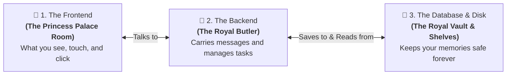
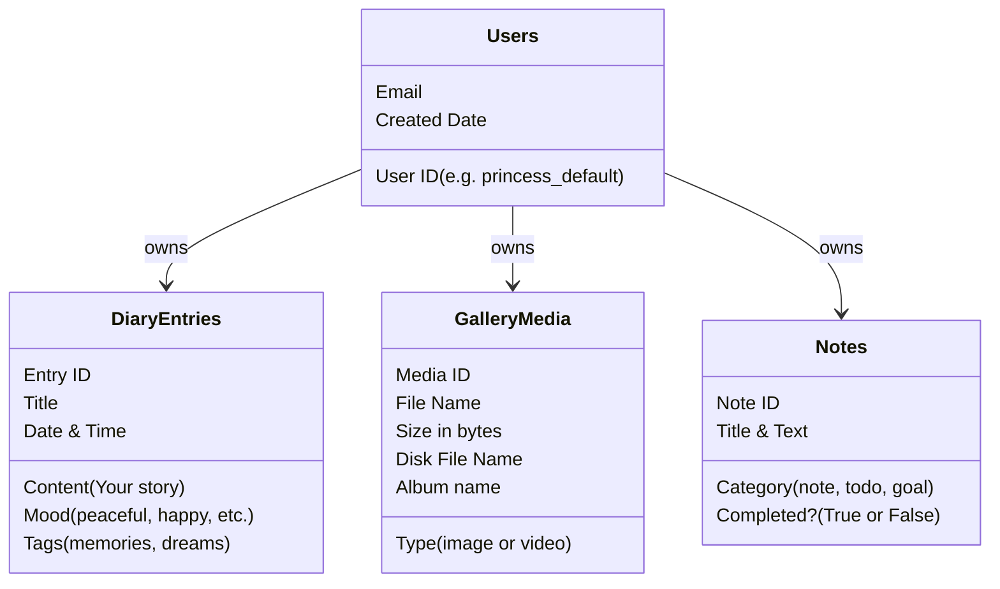

# 👑 My Private Princess Diary — Easy-to-Understand Guide

> **Who is this guide for?**  
> This guide is written for **everyone**! You don’t need to be a software engineer, computer science graduate, or coding expert. If you can use a web browser, you will easily understand how this application works from top to bottom.

---

## 🌟 1. The Big Picture (The 30-Second Summary)

Think of **My Private Princess Diary** as a modern, digital private diary with three main parts working together like a luxury palace:



1. **The Frontend (The Palace Room)**: The beautiful screen you look at with soft colors, animations, buttons, diary paper, and music.
2. **The Backend (The Royal Butler)**: The silent assistant working behind the curtain. It listens to what you want to do (save a page, upload a photo, delete a note) and handles the work.
3. **The Database & Storage (The Royal Vault)**: A safe lockbox on your computer where your written diary entries, to-do lists, and photo files stay stored permanently, even when you restart your PC.

---

## 🍽️ 2. The Simple Restaurant Analogy

If you have ever eaten at a restaurant, you already understand how this system works:

| Computer Term | Restaurant Analogy | What It Does in Our Diary App |
| :--- | :--- | :--- |
| **Frontend** (`React`) | **The Dining Table & Menu** | The screen where you type your thoughts, see your photos, and click buttons. |
| **Backend API** (`FastAPI`) | **The Waiter / Butler** | Takes your order ("Please save this diary entry"), brings it to the kitchen, and returns a confirmation ("Done!"). |
| **Database** (`diary.db`) | **The Recipe Book & Pantry** | The organized binder where all text, dates, moods, and checklists are written down and locked safely. |
| **File Storage** (`uploads/`) | **The Refrigerator Shelves** | The actual storage space where big items (your photos and videos) are kept on your hard drive. |
| **IndexedDB** | **Your Personal Pocket Notepad** | A quick notebook right in your browser so you can read your notes instantly in 0.001 seconds without waiting. |

---

## 💻 3. Part 1: The Frontend (What You See on Your Screen)

### Where is it located?
Inside the folder: [`d:/chandini/frontend`](file:///d:/chandini/frontend)

### What technology is used?
* **React & TypeScript**: A popular technology made for building interactive websites. It makes buttons click smoothly, pages switch without refreshing the entire screen, and animations feel alive.
* **Tailwind CSS**: The styling toolkit that gives the app its royal anime-princess aesthetic—soft pinks, purples, sparkling borders, glass-like cards, and glowing buttons.

### What are the main sections?
1. **Home (`Home.tsx`)**: The welcome dashboard showing your quick statistics (how many diary pages you wrote, how many pictures you saved, your mood summary).
2. **Diary (`DiaryList.tsx` & `DiaryEntry.tsx`)**: Your digital journal. You can choose a mood (happy, peaceful, romantic, melancholic), add tags, and write your secrets.
3. **Gallery (`Gallery.tsx`)**: A photo and video album. You can drag and drop your favorite pictures or memories and view them full-screen.
4. **Notes & To-Do (`Notes.tsx`)**: Sticky notes, goals, gratitude lists, and daily to-do checklists with interactive tick-boxes.

### The Secret Superpower: "Instant Speed" with IndexedDB
Have you ever used an app where you click a button and have to stare at a spinning circle for 5 seconds? We hated that, so we added **IndexedDB**.
* **What is IndexedDB?** It is a built-in miniature storage system inside your web browser (like Chrome, Edge, or Safari).
* **How it helps you**: Whenever you click "Save", your diary entry is saved into your browser's private memory in less than **1 millisecond**. You can instantly click to another tab and back, and your content is already there!

---

## ⚙️ 4. Part 2: The Backend (The Butler Behind the Scenes)

### Where is it located?
Inside the folder: [`d:/chandini/backend`](file:///d:/chandini/backend)

### What technology is used?
* **Python (Version 3.13)**: A friendly, powerful, and secure programming language.
* **FastAPI**: A modern, high-speed Python framework designed to build "APIs" (bridges between apps).
* **Uvicorn**: The engine that runs Python and makes it listen for requests on your computer on **Port 8000**.

### What does the Backend actually do?
The backend provides **REST Endpoints** (think of them as specific bells you can ring to ask the butler for different services):

```
🔔 Ring "POST /api/diary"    ──> "Butler, please save this new diary page."
🔔 Ring "GET  /api/diary"    ──> "Butler, please give me all my saved diary pages."
🔔 Ring "POST /api/gallery/upload" ──> "Butler, please store this photo in the vault."
🔔 Ring "GET  /api/gallery/file/123" ──> "Butler, please show me photo #123."
🔔 Ring "PATCH /api/notes/5/toggle"  ──> "Butler, please mark task #5 as completed."
```

### Why two numbers: Port 5173 and Port 8000?
When you run the app on your computer:
* **Port 5173 (`http://localhost:5173`)**: This is the **Frontend** address. You type this into your browser to see the user interface.
* **Port 8000 (`http://127.0.0.1:8000`)**: This is the **Backend** address where Python is waiting to receive and save data.
* **The Magic Bridge (Proxy)**: The frontend automatically sends all `/api` requests to Port 8000 behind the scenes, so you never have to worry about configuring ports.

---

## 🗄️ 5. Part 3: The Database & Storage (Where Your Data Lives)

### 1. The Database File: `diary.db`
All your text is saved in a single file on your computer:
[`d:\chandini\backend\diary.db`](file:///d:/chandini/backend/diary.db)
* It uses **SQLite**, a rock-solid database format trusted by Apple, Google, and Microsoft.
* Inside this file are four neatly organized tables (like sheets in an Excel document):



### 2. The Media Folder: `uploads/`
Where do photos and videos go?
* Text is tiny, so it goes into `diary.db`.
* Photos and videos can be large (up to 200 Megabytes!), so they are saved directly as real files inside:
  [`d:\chandini\backend\uploads`](file:///d:/chandini/backend/uploads)
* When you upload `my_vacation.jpg`, the backend gives it a secure, unique ID like `b3f9421a.jpg` so names never clash or overwrite each other.

---

## 🔄 6. Step-by-Step Stories: What Happens When You Use the App?

### Story A: You write a diary entry and click "Save Page"
```
1. You type your thoughts into the diary form and click "Save Page".
   ↓
2. [Frontend] Instantly saves a copy into your browser's private IndexedDB.
   Result: You see "Saved!" immediately. No waiting!
   ↓
3. [Background] Frontend silently sends a message to Python:
   "Hey FastAPI, please save this entry in diary.db too!"
   ↓
4. [Backend] Python validates the information and writes it into the diary.db file.
   ↓
5. Result: Even if you clear your browser history or open the app on another tab,
   your diary entry is completely safe in both places.
```

### Story B: You upload a photo to your Gallery
```
1. You drag a photo (e.g., cute_princess.png) into the Gallery drop zone.
   ↓
2. [Check] The frontend checks:
   • Is it an image or video? Yes.
   • Is it smaller than 200MB? Yes.
   ↓
3. [Instant Preview] The browser creates an instant local preview so you see the picture immediately.
   ↓
4. [Upload] The frontend packages the image and uploads it to Python:
   POST /api/gallery/upload
   ↓
5. [Save to Disk] Python streams the file into the "d:\chandini\backend\uploads\" folder.
   ↓
6. [Record in Database] Python adds a record in diary.db noting the file name, size, and date.
   ↓
7. Done! The photo is safely stored on your hard drive.
```

### Story C: You check off a To-Do item
```
1. You click the small circle checkbox next to "Water the palace roses".
   ↓
2. The checkbox immediately turns into a pink checkmark with strikethrough text.
   ↓
3. Python backend updates completed = True in diary.db.
```

---

## 📖 7. Beginner Jargon Buster (The "Cheat Sheet")

| Term | What It Means in Plain English |
| :--- | :--- |
| **Frontend** | Everything you can see, read, and click on your screen. |
| **Backend** | The silent program running on your machine doing the heavy work (saving files, managing data). |
| **Database** | A digital filing cabinet that keeps records organized and easy to search. |
| **API (Application Programming Interface)** | A waiter that carries requests from the frontend to the backend and brings back answers. |
| **IndexedDB** | A quick notepad stored directly inside your browser so pages load with zero delay. |
| **JSON** | A clean, human-readable way for computers to format messages (e.g. `{"title": "My Day", "mood": "happy"}`). |
| **Port (e.g. 5173, 8000)** | Like apartment room numbers in a building. Port 5173 is the Frontend apartment; Port 8000 is the Backend apartment. |
| **Localhost** | A computer's nickname for "this computer right here" (not somewhere out on the internet). |

---

## 🚀 8. How to Run the App (Easy Step-by-Step)

If you ever need to start the application from scratch, follow these two simple steps:

### Step 1: Start the Backend (The Butler)
Open a terminal (PowerShell) and run:
```powershell
cd d:\chandini\backend
.\.venv\Scripts\Activate.ps1
uvicorn main:app --port 8000
```
> You will see: `Uvicorn running on http://127.0.0.1:8000`. This means your butler is ready!

### Step 2: Start the Frontend (The Palace Room)
Open a second terminal (PowerShell) and run:
```powershell
cd d:\chandini\frontend
npm run dev
```
> You will see: `Local: http://localhost:5173/`.  
> Hold `Ctrl` and click the link (or open your web browser and go to `http://localhost:5173`).

---

## ❓ 9. Frequently Asked Questions (FAQ)

### Q1: Is my diary data sent to the public internet?
**No.** Everything runs locally on your own machine. Your diary entries, notes, photos, and database live on your own hard drive at `d:\chandini`.

### Q2: Can I use the diary if my Wi-Fi is disconnected?
**Yes!** Because of the built-in IndexedDB system, you can open the app, write diary pages, review notes, and browse your gallery even completely offline.

### Q3: Where can I see my uploaded photos in Windows?
Open Windows File Explorer and navigate to:  
📁 `d:\chandini\backend\uploads\`  
All your uploaded image and video files are stored right there.

### Q4: How do I know everything is working properly?
You can open this link in your web browser:  
👉 [http://127.0.0.1:8000/docs](http://127.0.0.1:8000/docs)  
This opens the interactive **Swagger Control Panel**, which lets you test and view every single backend command directly.
